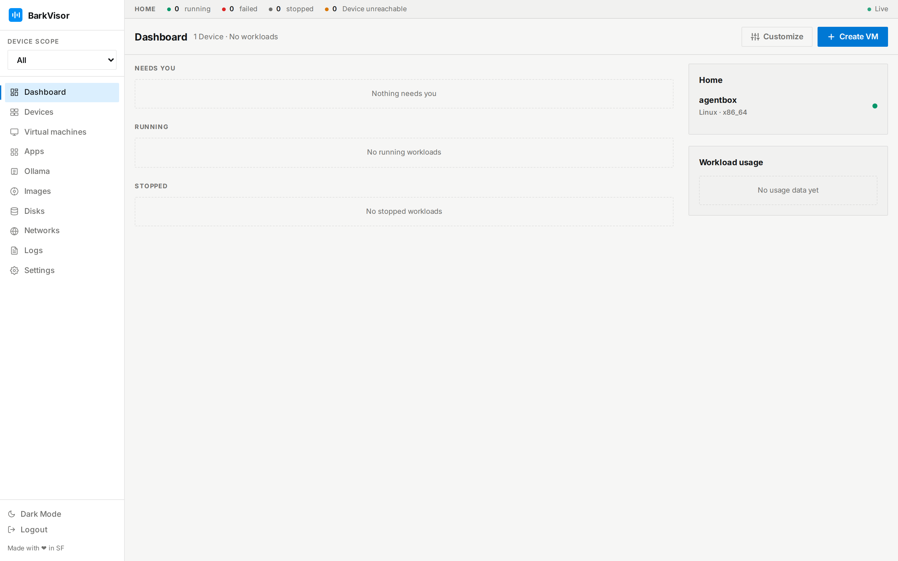

# Issue #787 dashboard capture

The [question on issue #787](https://github.com/pmdroid/barkvisor/issues/787#issuecomment-6100509053) asked which screen to capture. Pascal [selected option 1](https://github.com/pmdroid/barkvisor/issues/787#issuecomment-6104685600), "Dashboard after local setup", before this run.

Captured from commit `95b678cc5da7088ddbfea5b70d792d6a4e158539` on Linux using the real Swift daemon and built Vue frontend. The throwaway instance used ephemeral HTTP and agent ports, a fresh data directory, and headless admin provisioning through `scripts/dev-instance.sh`. Playwright opened the dashboard and clicked its sidebar link before capture.

Verification passed:

- `swift build --product BarkVisorApp --jobs 4`.
- `bun run build` in `frontend`.
- The verification skill's doctor checked health, completed setup, admin authentication, and build identity.
- Dashboard headings and all three feed sections rendered.
- The single device card and ticker counts matched `/api/home/devices/health`.
- The browser reported no page errors or HTTP responses with status 400 or higher.

The capture uses a 1440 × 900 viewport at device scale 2. The verification skill's hostname redaction ran before capture. [run.json](run.json) records the timestamp, build identity, API results, and browser checks. The instance was stopped and its temporary data removed after capture.
